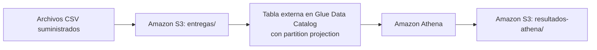

# Intentos de entrega: S3 + Glue Data Catalog con partition projection + Athena

Una empresa de mensajería recibe un CSV diario con los intentos de entrega. Los archivos se guardan en Amazon S3 y se describen con una tabla externa de Glue Data Catalog que usa **partition projection** por fecha. Así, Athena consulta cada nuevo día **sin crawlers, sin `MSCK REPAIR TABLE` y sin `ALTER TABLE ADD PARTITION`**. Toda la infraestructura se define en Terraform.



## Contenido del repositorio

```text
.
├── README.md                      Instrucciones reproducibles (este archivo)
├── .gitignore                     Excluye credenciales, estado de Terraform y .terraform/
├── infraestructura/
│   ├── principal.tf               Terraform, proveedor AWS, bucket, Glue (base y tabla con proyección) y workgroup
│   ├── variables.tf               Región, nombres y rango de la proyección
│   └── salidas.tf                 Outputs: bucket, base de datos, tabla, workgroup, rutas
├── consultas/
│   ├── intentos_por_fecha_estado.sql
│   ├── porcentaje_exito_por_fecha_ciudad.sql
│   ├── duracion_promedio_2026-10-02.sql
│   └── verificacion_tercer_dia.sql   (3 sentencias: registros, conteo por estado y total)
├── resultados/
│   ├── inicial/                   Resultados de Athena con los días 1 y 2
│   └── final/                     Resultados de Athena con los días 1, 2 y 3
├── evidencias/
│   ├── aplicacion_terraform.txt   Salida de terraform apply
│   ├── outputs.json               terraform output -json
│   ├── ejecuciones_athena.csv     etapa, archivo_sql, id_ejecucion, archivo_resultado
│   └── eliminacion_terraform.txt  Salida de terraform destroy y verificación
├── respuestas.md                  Preguntas conceptuales
├── scripts/ejecutar_consulta.sh   Programa propio: ejecuta una sentencia en Athena, descarga el CSV y registra la ejecución
├── data/entregas/                 CSV suministrados (sin modificar)
└── resultados_esperados/          Referencias suministradas (no se suben a S3)
```

## 1. Prerrequisitos

| Herramienta | Versión usada | Comprobación |
| --- | --- | --- |
| Ubuntu (WSL2) con Bash | 22.04 / 24.04 | `bash --version` |
| AWS CLI v2 | 2.x | `aws --version` |
| Terraform | ≥ 1.5 (usado 1.17.1) | `terraform -version` |
| Proveedor `hashicorp/aws` | ~> 5.0 | lo instala `terraform init` |

- Credenciales de un usuario IAM configuradas con `aws configure` (no la cuenta raíz). Se guardan en `~/.aws/`, fuera del repositorio.
- Permisos necesarios: S3 (crear y eliminar el bucket, configurar el bloqueo de acceso público, `PutObject`/`GetObject`/`ListBucket`), Glue (`CreateDatabase`, `CreateTable`, `GetTable`, `GetPartitions`, `DeleteTable`, `DeleteDatabase`) y Athena (`CreateWorkGroup`, `StartQueryExecution`, `GetQueryExecution`, `GetQueryResults`, `DeleteWorkGroup`).
- **Región:** `us-east-1`, definida en la variable `region`.

Comprobar la identidad y la región antes de empezar:

```bash
aws sts get-caller-identity
aws configure get region
```

## 2. Configuración

Todos los valores tienen un valor por defecto en `infraestructura/variables.tf`, así que no hace falta un archivo `.tfvars`:

| Variable | Valor por defecto | Uso |
| --- | --- | --- |
| `region` | `us-east-1` | Región del despliegue |
| `proyecto` | `de-final-entregas` | Prefijo de nombres y etiquetas |
| `nombre_bucket` | `""` | Si está vacío: `de-final-entregas-<cuenta>-us-east-1` (nombre único global) |
| `nombre_base_datos` | `entregas_db` | Base de datos de Glue |
| `nombre_tabla` | `entregas` | Tabla externa |
| `nombre_workgroup` | `entregas-wg` | Workgroup de Athena |
| `fecha_inicio` / `fecha_fin` | `2026-10-01` / `2026-10-03` | Rango de la proyección (ambos incluidos) |

> Las consultas SQL usan `entregas_db.entregas`. Si se cambian `nombre_base_datos` o `nombre_tabla`, también hay que cambiar los `.sql`.

### Recursos que crea Terraform

1. **Bucket S3 privado**, con bloqueo total de acceso público, propiedad de objetos `BucketOwnerEnforced` (sin ACL) y cifrado SSE-S3.
2. **Prefijos** `entregas/` (datos) y `resultados-athena/` (resultados de Athena) dentro del mismo bucket. No se crean carpetas: son parte de las claves de los objetos.
3. **Base de datos** de Glue Data Catalog `entregas_db`.
4. **Tabla externa** `entregas`:
   - Columnas en el orden del CSV: `id_envio string`, `ciudad string`, `transportadora string`, `estado string`, `duracion_minutos int`.
   - `LazySimpleSerDe` con `field.delim = ','` y `skip.header.line.count = 1` para omitir el encabezado.
   - Clave de partición `fecha string`, separada de las columnas (no existe dentro del CSV).
   - Partition projection:

     | Propiedad | Valor |
     | --- | --- |
     | `projection.enabled` | `true` |
     | `projection.fecha.type` | `date` |
     | `projection.fecha.format` | `yyyy-MM-dd` |
     | `projection.fecha.range` | `2026-10-01,2026-10-03` |
     | `projection.fecha.interval` | `1` |
     | `projection.fecha.interval.unit` | `DAYS` |
     | `storage.location.template` | `s3://<bucket>/entregas/fecha=${fecha}/` (prefijo de la partición, termina en `/`) |
   - No se crea ninguna partición individual.
5. **Workgroup de Athena** `entregas-wg`, con resultados en `s3://<bucket>/resultados-athena/` y la configuración forzada (`enforce_workgroup_configuration = true`).
6. **Outputs:** `bucket`, `base_datos`, `tabla`, `tabla_completa`, `workgroup`, `ruta_datos`, `ruta_resultados_athena`, `plantilla_ubicacion`, `rango_proyeccion` y `region`.

## 3. Despliegue

Desde la raíz del repositorio:

```bash
mkdir -p evidencias
cd infraestructura
terraform init
terraform fmt -check
terraform validate
terraform plan
terraform apply -auto-approve -no-color 2>&1 | tee ../evidencias/aplicacion_terraform.txt
terraform output -json > ../evidencias/outputs.json
cd ..
```

Guardar el nombre del bucket para los pasos siguientes:

```bash
BUCKET=$(terraform -chdir=infraestructura output -raw bucket)
echo "$BUCKET"
```

Comprobar las propiedades de la tabla en el catálogo:

```bash
aws glue get-table --database-name entregas_db --name entregas \
  --query 'Table.{Particion:PartitionKeys,Propiedades:Parameters}'
aws glue get-partitions --database-name entregas_db --table-name entregas --query 'length(Partitions)'
```

El segundo comando devuelve `0`: no hay particiones registradas, todas se resuelven por proyección.

## 4. Demostración inicial: días 1 y 2

### 4.1 Carga de archivos (uno por uno, sin carga recursiva)

Solo se cargan los días 1 y 2. El archivo del día 3 se queda en el equipo local.

```bash
aws s3 cp "data/entregas/fecha=2026-10-01/entregas.csv" "s3://$BUCKET/entregas/fecha=2026-10-01/entregas.csv"
aws s3 cp "data/entregas/fecha=2026-10-02/entregas.csv" "s3://$BUCKET/entregas/fecha=2026-10-02/entregas.csv"
aws s3 ls "s3://$BUCKET/entregas/" --recursive
```

| Archivo local | Objeto de destino |
| --- | --- |
| `data/entregas/fecha=2026-10-01/entregas.csv` | `s3://<bucket>/entregas/fecha=2026-10-01/entregas.csv` |
| `data/entregas/fecha=2026-10-02/entregas.csv` | `s3://<bucket>/entregas/fecha=2026-10-02/entregas.csv` |

En este punto la tabla tiene **12 registros**. El rango ya incluye el 2026-10-03, pero ese prefijo todavía no tiene objetos y por eso no aporta filas.

### 4.2 Ejecución de consultas (etapa `inicial`)

`scripts/ejecutar_consulta.sh` hace cuatro cosas:
1. Ejecuta una sentencia en el workgroup `entregas-wg` (base `entregas_db`).
2. Espera a que termine.
3. Descarga el CSV que Athena escribió en `resultados-athena/`, quitando las comillas para dejarlo en el mismo formato de las referencias.
4. Agrega una fila a `evidencias/ejecuciones_athena.csv` con `etapa`, `archivo_sql`, `id_ejecucion` y `archivo_resultado`, usando rutas relativas a la raíz.

```bash
bash scripts/ejecutar_consulta.sh inicial consultas/intentos_por_fecha_estado.sql         resultados/inicial/intentos_por_fecha_estado.csv
bash scripts/ejecutar_consulta.sh inicial consultas/porcentaje_exito_por_fecha_ciudad.sql resultados/inicial/porcentaje_exito_por_fecha_ciudad.csv
bash scripts/ejecutar_consulta.sh inicial consultas/duracion_promedio_2026-10-02.sql      resultados/inicial/duracion_promedio_2026-10-02.csv
```

Las mismas consultas también se pueden pegar en el editor de Athena de la consola, con el workgroup `entregas-wg` seleccionado.

Decisiones de las consultas:
- **Intentos:** `COUNT(*)` por `fecha, estado`, ordenado por fecha y estado de forma ascendente.
- **Porcentaje de éxito:** `100 × SUM(estado = 'entregado') / COUNT(*)`. El denominador incluye los tres estados. Se convierte a `DOUBLE` para evitar la división entera y a `DECIMAL(5,2)` para mostrar siempre dos decimales.
- **Duración promedio:** `AVG(duracion_minutos)` filtrando `estado = 'entregado'` y `fecha = '2026-10-02'`, de modo que los ceros de los intentos fallidos no entran en el promedio. El resultado también se presenta como `DECIMAL(10,2)`.
- Las consultas de intentos y porcentaje **no tienen filtro de fecha**. Recorren todo el rango proyectado, así que el mismo SQL sirve para la etapa final sin cambios.

### 4.3 Comparación con las referencias

```bash
diff resultados/inicial/intentos_por_fecha_estado.csv         resultados_esperados/intentos_por_fecha_estado_inicial.csv         && echo "intentos: IGUAL"
diff resultados/inicial/porcentaje_exito_por_fecha_ciudad.csv resultados_esperados/porcentaje_exito_por_fecha_ciudad_inicial.csv && echo "porcentaje: IGUAL"
diff resultados/inicial/duracion_promedio_2026-10-02.csv      resultados_esperados/duracion_promedio_2026-10-02.csv              && echo "duracion: IGUAL"
```

Resultado esperado: 6 filas de intentos, 4 de porcentajes y 1 de duración (`2026-10-02,36.67`). Las tres comparaciones dan `IGUAL`.

## 5. Nueva fecha: día 3 (solo subir y consultar)

Para incorporar el día 3 **no se modifica la infraestructura ni la tabla**. Tampoco se ejecutan crawlers, `MSCK REPAIR TABLE`, `ALTER TABLE ADD PARTITION` ni `terraform apply`.

### 5.1 Carga del tercer archivo

```bash
aws s3 cp "data/entregas/fecha=2026-10-03/entregas.csv" "s3://$BUCKET/entregas/fecha=2026-10-03/entregas.csv"
aws s3 ls "s3://$BUCKET/entregas/" --recursive
```

### 5.2 Verificación del tercer día (etapa `final`)

`consultas/verificacion_tercer_dia.sql` contiene tres sentencias. Athena ejecuta una por ejecución, así que se indica su número:

```bash
bash scripts/ejecutar_consulta.sh final consultas/verificacion_tercer_dia.sql resultados/final/verificacion_tercer_dia.csv 1
bash scripts/ejecutar_consulta.sh final consultas/verificacion_tercer_dia.sql resultados/final/verificacion_conteo_estados_tercer_dia.csv 2
bash scripts/ejecutar_consulta.sh final consultas/verificacion_tercer_dia.sql resultados/final/verificacion_total_registros.csv 3
```

| Sentencia | Resultado | Valor esperado |
| --- | --- | --- |
| 1. Registros del 2026-10-03 | `resultados/final/verificacion_tercer_dia.csv` | 6 filas (`ENV-013` a `ENV-018`) |
| 2. Conteo por estado del 2026-10-03 | `resultados/final/verificacion_conteo_estados_tercer_dia.csv` | `destinatario_ausente` 3, `direccion_incorrecta` 1, `entregado` 2 |
| 3. Total de la tabla | `resultados/final/verificacion_total_registros.csv` | `total_registros = 18`, `registros_tercer_dia = 6`, `fechas_con_datos = 3` |

### 5.3 Consultas agregadas sobre los tres días

Se ejecutan de nuevo **los mismos archivos SQL**, sin ningún cambio:

```bash
bash scripts/ejecutar_consulta.sh final consultas/intentos_por_fecha_estado.sql         resultados/final/intentos_por_fecha_estado.csv
bash scripts/ejecutar_consulta.sh final consultas/porcentaje_exito_por_fecha_ciudad.sql resultados/final/porcentaje_exito_por_fecha_ciudad.csv

diff resultados/final/intentos_por_fecha_estado.csv         resultados_esperados/intentos_por_fecha_estado_final.csv         && echo "intentos final: IGUAL"
diff resultados/final/porcentaje_exito_por_fecha_ciudad.csv resultados_esperados/porcentaje_exito_por_fecha_ciudad_final.csv && echo "porcentaje final: IGUAL"
```

Resultado esperado: 9 filas de intentos y 6 de porcentajes, ambas iguales a las referencias finales. El archivo de intentos también confirma los conteos por estado del tercer día. El promedio de duración sigue correspondiendo al día 2 y mantiene su referencia de la etapa inicial.

Para confirmar que la tabla no cambió:

```bash
aws glue get-partitions --database-name entregas_db --table-name entregas --query 'length(Partitions)'
aws glue get-table --database-name entregas_db --name entregas --query 'Table.Parameters."projection.fecha.range"'
```

Debe dar `0` particiones registradas y el mismo rango `2026-10-01,2026-10-03`.

### 5.4 Registro de ejecuciones

`evidencias/ejecuciones_athena.csv` queda con 3 ejecuciones `inicial` y 5 `final`. Cada una relaciona el archivo SQL, el `QueryExecutionId` de Athena y el archivo de resultado. Si una ejecución se repite, la fila sobrante se borra a mano para que quede una fila por resultado entregado.

## 6. Limpieza

Primero se guardan y confirman todas las evidencias y resultados. Después se eliminan los recursos:

```bash
BUCKET=$(terraform -chdir=infraestructura output -raw bucket)

# 1) Vaciar el bucket: datos de entregas/ y resultados de resultados-athena/
aws s3 rm "s3://$BUCKET" --recursive

# 2) Eliminar todos los recursos con Terraform y guardar la evidencia
mkdir -p evidencias
cd infraestructura
terraform destroy -auto-approve -no-color 2>&1 | tee ../evidencias/eliminacion_terraform.txt
cd ..

# 3) Verificar que ya no existen y agregar la verificación a la evidencia
{
  echo; echo "=== Verificación posterior a la eliminación ==="
  echo "\$ terraform state list";  terraform -chdir=infraestructura state list; echo "(vacío = sin recursos)"
  echo "\$ aws s3api head-bucket --bucket $BUCKET"; aws s3api head-bucket --bucket "$BUCKET" 2>&1
  echo "\$ aws glue get-database --name entregas_db"; aws glue get-database --name entregas_db 2>&1
  echo "\$ aws athena get-work-group --work-group entregas-wg"; aws athena get-work-group --work-group entregas-wg 2>&1
} >> evidencias/eliminacion_terraform.txt
tail -20 evidencias/eliminacion_terraform.txt
```

Resultado esperado: `Destroy complete! Resources: 7 destroyed.` Luego, errores de "no encontrado" para el bucket (404), la base de datos (`EntityNotFoundException`) y el workgroup (`InvalidRequestException`).

`force_destroy = true` en el bucket y en el workgroup permite eliminar el bucket y el historial de consultas aunque el bucket no se haya vaciado antes. La eliminación sigue haciéndose solo con Terraform.

## 7. Seguridad

- No se publican credenciales: las de AWS viven en `~/.aws/`, fuera del repositorio.
- `.gitignore` excluye `.terraform/`, `*.tfstate*`, `*.tfvars`, `.env` y llaves.
- `terraform.tfstate` se guarda solo en local y no se sube.
- El bucket es privado: tiene bloqueo de acceso público, no usa ACL y está cifrado.
- Los CSV de `resultados_esperados/` nunca se suben al prefijo `entregas/`.
